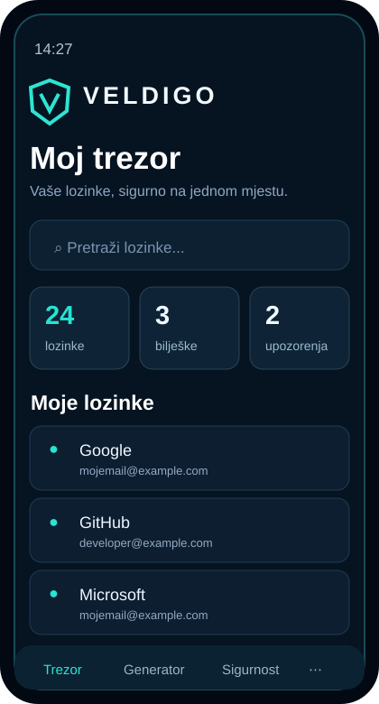
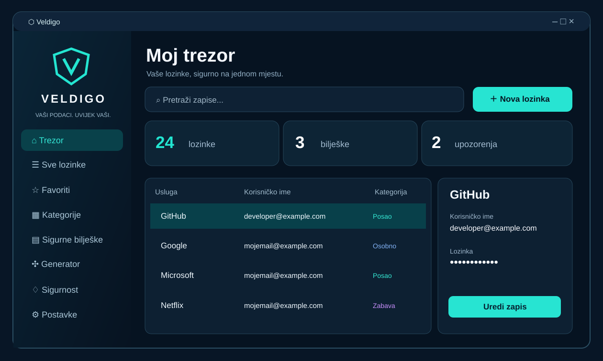

# Vaše lozinke. Vaša kontrola.

**Jedno sigurno mjesto za vaše lozinke, pristupne podatke i privatne bilješke.**

**Android** &nbsp; • &nbsp; **Windows** &nbsp; • &nbsp; **Lokalni šifrirani trezor**

---

## Manje pamćenja. Više kontrole.

Veldigo objedinjuje svakodnevne digitalne podatke u preglednoj aplikaciji
koja je jednako ugodna na telefonu i računalu. Vaši su računi organizirani,
lozinke skrivene od znatiželjnih pogleda, a nova snažna lozinka udaljena
samo nekoliko dodira.

## Sve važno na jednom mjestu

|  | **Vaši računi, pregledno organizirani.** Spremite naziv usluge, korisničko ime, lozinku, web-adresu i dodatnu bilješku. |
|---|---|
| **02 · Generator** | Stvorite jedinstvene lozinke uz kontrolu duljine i vrste znakova. |
| **03 · Sigurne bilješke** | Pohranite privatne tekstove i osjetljive informacije u šifrirani trezor. |
| **04 · Kartice** | Spremite podatke o karticama zaštićene glavnom lozinkom. |
| **05 · Autentifikator** | Stvarajte vremenski ograničene TOTP kodove iz ručno unesenih tajnih ključeva. |
| **06 · Sigurnosni centar** | Provjerite ponovljene i jednostavne lozinke prema lokalnim pravilima. |
| **07 · Sigurnosna kopija** | Izvezite i vratite zaštićenu datoteku trezora te prenesite zapise između uređaja. |
| **08 · Favoriti i kategorije** | Pronađite najčešće korištene račune bez suvišnog pretraživanja. |

## Dizajn prilagođen svakom zaslonu

**Na Androidu** Veldigo nudi intuitivnu navigaciju pri dnu zaslona, pregledne
kartice i jednostavno dodavanje zapisa.

**Na Windowsu** koristi bočnu navigaciju, popis računa i detalje odabranog
zapisa, uz prozor čiju veličinu možete slobodno prilagoditi.

Obje aplikacije dijele prepoznatljive tamne površine, tirkizne akcente i
Veldigo vizualni identitet.

## Privatnost ostaje u vašim rukama

- **AES-256-GCM** za šifriranje i provjeru integriteta trezora.
- **Argon2id** za izvođenje ključa iz glavne lozinke.
- **Lokalna pohrana** bez obveznog računa ili vanjskog poslužitelja.
- **Šifrirani izvoz** za samostalno čuvanje sigurnosnih kopija.
- **Kontrolirani oporavak** uz zadržavanje prethodnih verzija podataka.

**Važno:** glavna lozinka ne može se resetirati putem udaljenog servisa.
Čuvajte je na sigurnome, kao i dodatnu šifriranu kopiju trezora.
Nijedan lokalni sustav ne može jamčiti oporavak nakon svakog kvara ili
gubitka uređaja.

## Veldigo za vaše uređaje

Preuzmite dostupne pakete i detalje izdanja putem
[**GitHub Releases**](https://github.com/bren-wp/Password-Manager/releases).

**Android:** APK i AAB paketi za podržane uređaje.

**Windows:** instalacijski program ili prijenosni paket bez klasične instalacije.

> Predizdanja služe za provjeru funkcionalnosti. AAB paketi potpisani
> testnim ključem nisu namijenjeni objavi na Google Playu, a Windows paketi
> bez kôdnog potpisa mogu prikazati sigurnosno upozorenje.

---

**VELDIGO** — Sigurno organiziran digitalni život.

© 2026 **Brendigo** · [MIT licenca](LICENSE)

